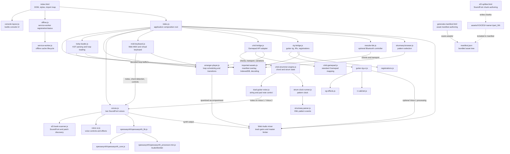
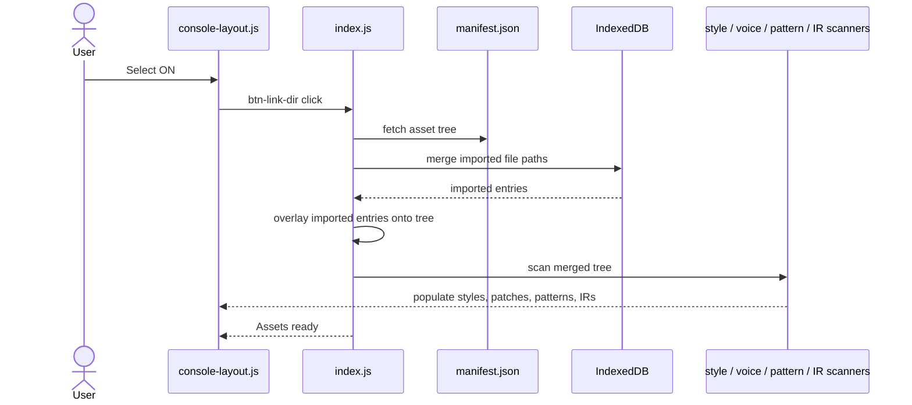
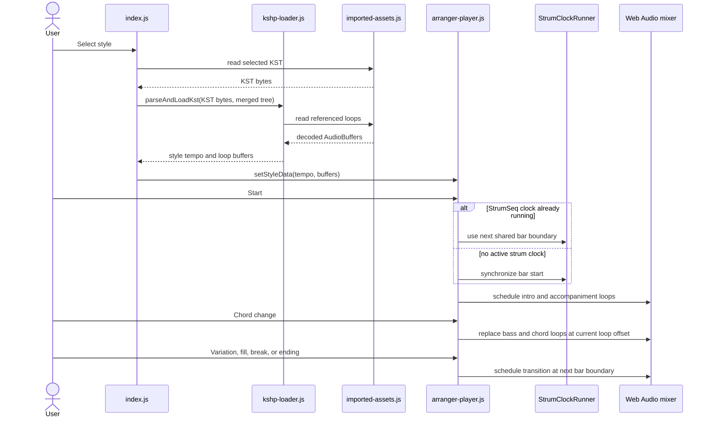
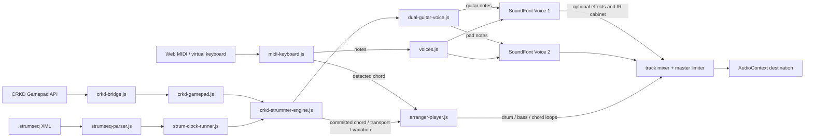
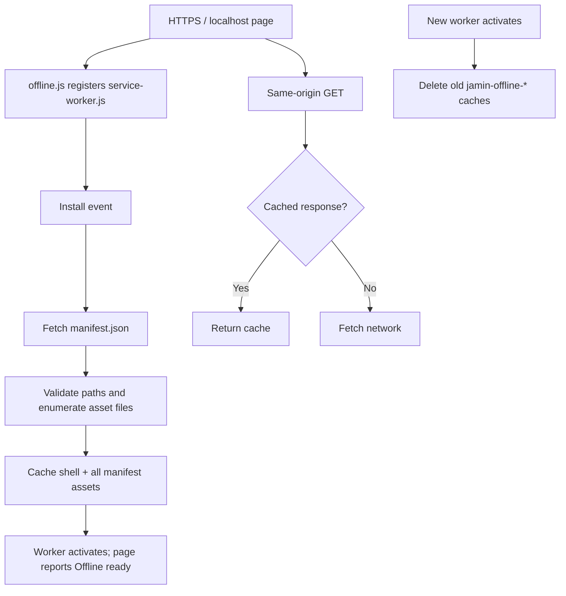

# Architecture

Jamin is a static browser application. It has no server-side runtime, bundler,
or compile step: the browser loads the classic scripts and ES modules directly
from the repository. `index.html` provides the initial DOM and import map;
`console-layout.js` moves those controls into the performance-console layout
before the `index.js` module executes.

## Project and dependency map

The manifest generator and SoundFont splitter are authoring utilities, not
runtime dependencies. `manifest.json` describes the `assets/` tree and is read
by the application and service worker. The import map in `index.html` resolves
the `spessasynth_core`, `fflate`, and `stb-vorbis` module names used by the
vendored synthesizer.

### Main source areas

| Area | Responsibility |
| --- | --- |
| `index.html`, `console-layout.js`, `index.css`, `console.css` | Static page, dynamic console layout, and presentation |
| `index.js` | Creates shared audio/mixer state, connects feature modules, and handles asset/style selection |
| `imported-assets.js`, `manifest.json`, `assets/` | Built-in and imported asset tree; imported files are persisted in IndexedDB |
| `kshp-loader.js`, `arranger-player.js` | Extract style metadata and audio-loop paths, then schedule accompaniment |
| `voices.js`, `voice-ui.js`, `sf2-bank-scanner.js`, `spessasynth/` | SoundFont discovery, patch selection, voice settings, and AudioWorklet synthesis |
| `crkd-*.js`, `dual-guitar-voice.js`, `guitar-voicing.js`, `strum-clock-runner.js`, `strumseq-*.js` | Gamepad mapping, guitar voicing, dual-voice performance, and sequenced strumming |
| `midi-keyboard.js`, `neouke-ble.js` | MIDI, on-screen keyboard, and optional Bluetooth controller input |
| `rig-bridge.js`, `guitar-rig-ui.js`, `xg-effects.js`, `ir-cabinet.js`, `registrations.js` | Guitar processing, impulse responses, and saved performance state |
| `offline.js`, `service-worker.js`, `web-manifest.json` | Installable web app metadata and offline caching |
| `test/` | Node test suite for imported assets, gamepad input, and service-worker behavior |
| `generate-manifest.html`, `sf2-splitter.html`, `convert-wav-to-flac.ps1` | Asset preparation utilities; not loaded by the application |

## Core workflows

### Startup and asset discovery

Selecting **ON** fetches `manifest.json`, overlays imported files from
IndexedDB, then scans the merged tree for styles, SoundFonts, strum patterns,
and IRs. The merged tree is an in-memory index: built-in files are fetched by
path, while imported files are read from IndexedDB.

### Style load and arranger playback

A selected `.KST` style contains tempo and references to its drum, bass, and
chord loop folders. `index.js` reads the style file, then `kshp-loader.js`
extracts those references, reads and decodes the audio files in small batches,
and returns buffers to `arranger-player.js`. Playback uses Web Audio buffer
sources, one gain route per accompaniment track, and a shared master
compressor. Variation, fill, break, and ending transitions are scheduled
against the current bar phase; chord changes replace bass and chord loops
immediately while preserving their position in the loop.

The tempo-shift control changes playback rate and effective BPM. When the
strummer is active, the arranger uses its clock's bar start so the
accompaniment can enter on a shared downbeat. MIDI chord detection and
committed gamepad chords both feed `arranger-player.js`; the arranger owns
accompaniment state and quantized transitions.

### Live input and sound generation

MIDI notes can trigger both SoundFont voices; the keyboard input path also
detects multi-note chords and forwards them to the arranger. The CRKD bridge
polls a standard-mapped Gamepad and delegates button interpretation to
`CRKDGamepadController`. Its strummer engine resolves fret masks into voicings,
then drives Voice 1 guitar notes and sustaining Voice 2 pad notes through
`DualGuitarVoice`. `.strumseq` events are parsed into a sixteenth-note pattern
and scheduled by the strum clock.

The optional guitar rig inserts effects and an IR cabinet into Voice 1's audio
route while guitar mode is active; Voice 2 and arranger loops use their own
mixer channels. Mixer state is shared with the hardware mute and registration
controls.

### Import and persistence

Imports are ZIP files with recognized roots: `USER_STYLE`, `USER_MODELING`,
`USER_IR`, `VOICES`, and `STRUMSEQ`. The importer validates paths and the ZIP
directory, stages entries in IndexedDB, converts WAV audio to Ogg, then commits
the staged files so a failed import does not replace existing imports.
`mergeImportedAssets()` overlays these paths on the built-in manifest tree;
imported modeling audio takes precedence over a built-in audio file with the
same stem. User imports live in the browser's `jamin` database.

Registrations are a separate persistence mechanism: the 20 saved states are
JSON values in `localStorage`. They capture selected style and performance
controls, guitar settings, mixer levels, and selected voices. Imported assets
and registrations are local to the browser profile and are not synchronized.

### Offline lifecycle

`offline.js` registers the service worker only in a secure context. During
installation, `service-worker.js` fetches the asset manifest, validates its
paths, and caches both the application shell and every file in the manifest.
Progress and failures are reported to the page. Same-origin GET requests are
served cache-first; activation removes older `jamin-offline-*` caches.

The offline cache and imported IndexedDB files are independent stores.
Increment `CACHE_NAME` in `service-worker.js` when deploying app-shell or
bundled-asset changes, and regenerate or update `manifest.json` when the asset
tree changes.

## Dependencies and tests

There is no application build pipeline. The browser loads vendored SpessaSynth modules and the local Ogg encoder module
for WAV-to-Ogg import conversion.
`package.json` provides the Node test command; `fake-indexeddb` supports the
asset-import tests. Run `npm install` and `npm test` to execute the tests.
